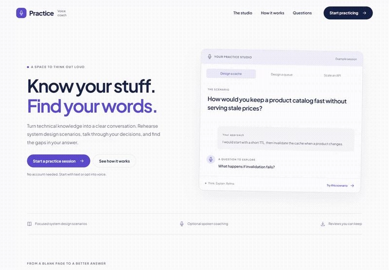

# Voice Practice Coach

A workspace for rehearsing system design explanations. Choose a scenario, write an answer, review the topics you covered, and keep a record of your practice. Optional AI feedback and live voice coaching extend the same workflow.

[Open the app](https://voice-practice-coach-production.up.railway.app) · [GitHub Actions](https://github.com/Swarneil1905/voice-practice-coach/actions) · [MIT license](LICENSE)

## Watch the walkthrough

[](docs/assets/walkthrough.mp4)

[Watch or download the full video](docs/assets/walkthrough.mp4) (00:00:34.12) · [View a still screenshot](docs/assets/preview.png). This silent recording shows the live text practice workflow. AI feedback and microphone sessions are optional and are not shown.

## Try it in a minute

1. Open the homepage, select a scenario and choose **Start practicing**.
2. Write your response in the practice studio and request a review.
3. Read the coverage feedback and the supporting excerpts from your answer.
4. Save the review, open **Saved reviews**, or export it as JSON.

The free review runs on the Django server without an external AI provider. It checks topic coverage, not whether an explanation is technically correct. Three system design scenarios are included.

## Current capabilities

| Feature | Behavior |
| --- | --- |
| Text practice | Scenario prompts, answer editing and evidence from the submitted response |
| Review journal | Explicit saves to this browser, with the latest 20 reviews retained |
| Export | Download a review as JSON |
| AI feedback | Requires provider credentials, consent and remaining shared allowance |
| Live coaching | Requires LiveKit and a voice worker; microphone controls and an eight minute session limit |

Saved reviews do not sync across devices. Audio is sent only after consent and browser microphone permission. The public paid allowance is shared across visitors; free text practice does not consume it.

## How it works

```text
Angular interface → Django API → Local topic coverage rubric
                              → Optional AI feedback provider
                              → Scoped LiveKit room token
Browser microphone ↔ LiveKit room ↔ Python voice worker
```

| Component | Responsibility |
| --- | --- |
| Angular | Scenarios, response editing, consent, review display and microphone lifecycle |
| Python / Django | Input validation, CSRF protection, review requests and voice access tokens |
| Python / LiveKit | Optional speech recognition, coaching responses and speech synthesis |
| Nginx | Serves the frontend and proxies API requests in Docker |

## Quick start with Docker

Requires Docker Desktop or Docker Engine with Compose. From the repository root:

```sh
docker compose up --build
```

Open **http://localhost:8080**. The default stack runs text practice without external credentials. Stop it with `docker compose down`.

## Run without Docker

Requires Python 3.10+ and Node.js 22.22+. Run these commands from the repository root in PowerShell:

```powershell
python -m venv .venv
.venv\Scripts\python.exe -m pip install -r api/requirements.txt
.venv\Scripts\python.exe api/manage.py runserver 127.0.0.1:8000
```

In a second terminal:

```sh
cd frontend
npm ci
npm start
```

Open **http://localhost:4200**. On macOS or Linux, use `.venv/bin/python` in place of `.venv\Scripts\python.exe`.

## Optional AI and voice configuration

Copy `.env.example` to `.env` for Docker. For native development, set the variables in the relevant terminals; Django does not load `.env` automatically.

| Variables | Purpose |
| --- | --- |
| `OPENAI_API_KEY` | Provider key held by the API for text and voice |
| `QUOTA_DATABASE` | Persistent SQLite file for the shared paid allowance |
| `VOICE_GATEWAY_URL`, `VOICE_GATEWAY_SECRET` | Worker connection to the budgeted API gateway |
| `ENABLE_VOICE=true` | Enable the voice token endpoint |
| `LIVEKIT_URL`, `LIVEKIT_API_KEY`, `LIVEKIT_API_SECRET` | Connect the API and worker to the same LiveKit project |

Set a random `VOICE_GATEWAY_SECRET` shared by API and worker. The worker never calls OpenAI directly. The gateway fixes the models and validates text, audio duration and output limits before reserving spend. With credentials configured, start the optional worker through Compose:

```sh
docker compose --profile voice up --build
```

Or install `agent/requirements.txt` into a Python environment and run:

```sh
python agent/worker.py download-files
python agent/worker.py dev
```

Audio leaves the browser only after consent and microphone permission. This application does not record audio; external provider retention policies still apply. Voice tokens expire after 120 seconds for joining, and the worker ends sessions after 480 seconds. The API allows three token requests per hour per observed IP. A separate lifetime ledger caps conservative paid reservations at $2 across all visitors and all paid operations. It never resets by day or month. This application guard does not control unrelated use of your API key or account.

## API

| Method | Path | Purpose |
| --- | --- | --- |
| GET | `/api/health` | Service health |
| GET | `/api/capabilities` | Available features and CSRF cookie |
| POST | `/api/practice/review` | Topic coverage or consented provider feedback |
| POST | `/api/voice/token` | Consented access to a scoped voice room |

The browser handles CSRF headers for POST requests. Invalid inputs and provider failures produce explicit errors.

## Development checks

```powershell
.venv\Scripts\python.exe api/manage.py test coach
.venv\Scripts\python.exe -m unittest discover -s agent -p 'test_*.py'
cd frontend
npm run build
```

GitHub Actions runs API and deadline tests, frontend and container builds, and production HTTP smoke tests before promoting the tested commit for Railway. Live audio and paid provider calls require manual verification with configured credentials. See the [verification notes](docs/verification.md) for the recorded local checks and limitations.

## Repository guide

| Path | Contents |
| --- | --- |
| `frontend/src/practice.ts` | Practice flow, consent and microphone controls |
| `api/coach/views.py` | Request handling, validation and provider integration |
| `api/coach/rubric.py` | Local coverage rules |
| `agent/` | Voice worker and session deadline tests |
| `docs/` | Architecture and verification details |

The public demo uses a bounded Nginx gateway and persistent paid usage allowances. See [deployment and operations](docs/deployment.md) for the release process, quota settings and rollback.

## Deployment and availability

The homepage is at `/`; the product workspace is at `/workspace`. The public Railway service uses sleep mode to reduce idle hosting costs. The first visit after inactivity can take longer while the service starts. Public requests are rate limited.

GitHub Actions checks frontend and backend code, builds the containers, tests the public HTTP path, and verifies both process failure handling and a clean Docker shutdown. Only a verified current `main` commit is promoted to the `production` branch that Railway deploys. A normal platform stop exits successfully; an unexpected required process exit fails the container.

The LiveKit worker runs as a separate Railway service without sleep mode. Paid operations pass through a persistent shared allowance; redeploying the web service does not reset it.

See [deployment and operations](docs/deployment.md) for configuration and rollback, and [architecture](docs/architecture.md) for the service boundaries.

## License

Original project code is licensed under the [MIT License](LICENSE), copyright © 2026 Swarneil Pradhan. Bundled fonts retain their SIL Open Font Licenses in [`frontend/public/fonts`](frontend/public/fonts). Third party dependencies retain their respective licenses.
